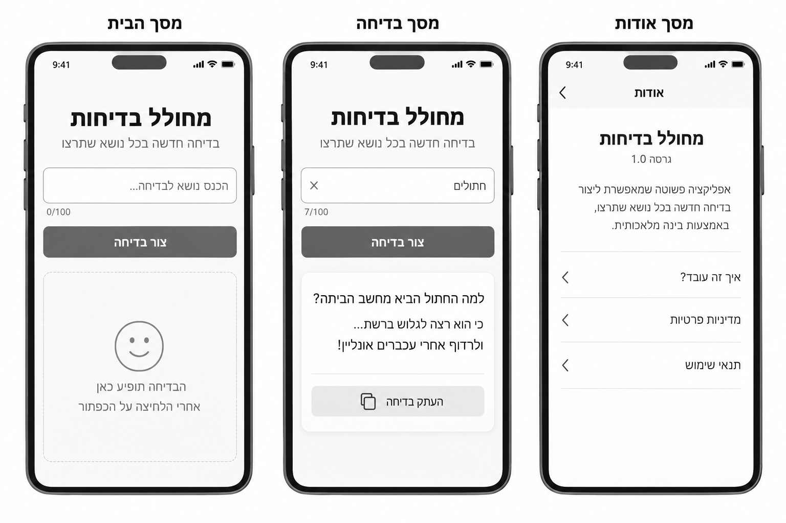
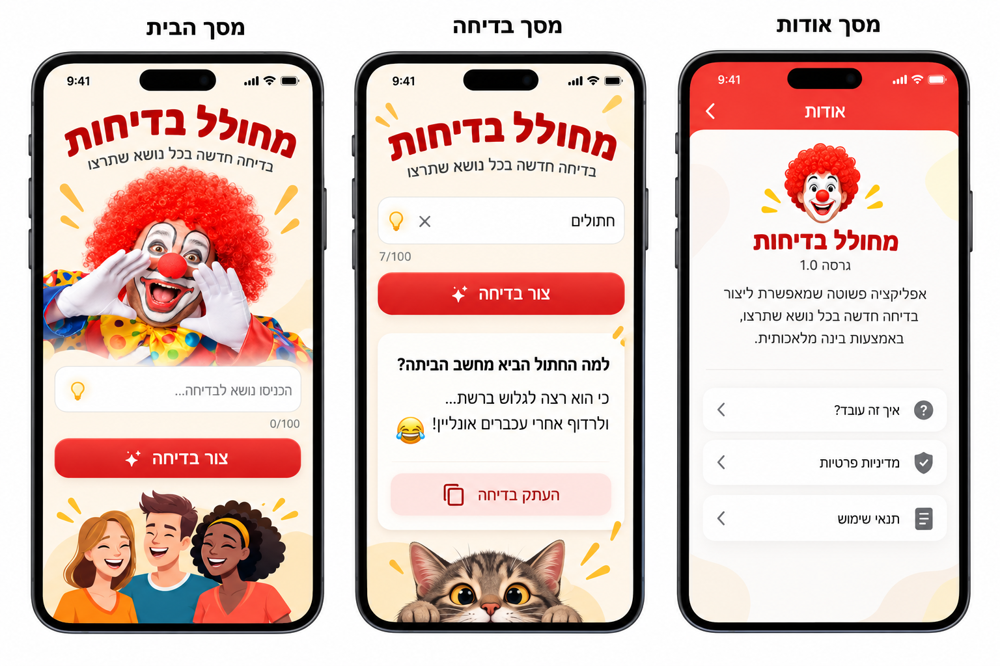
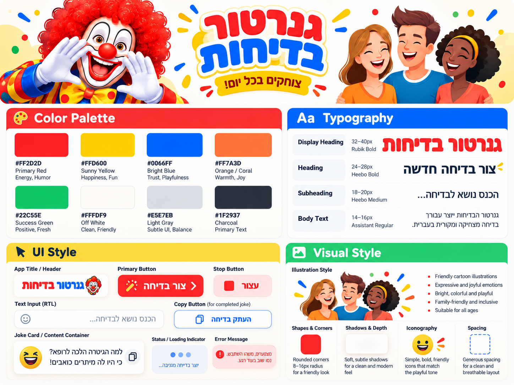
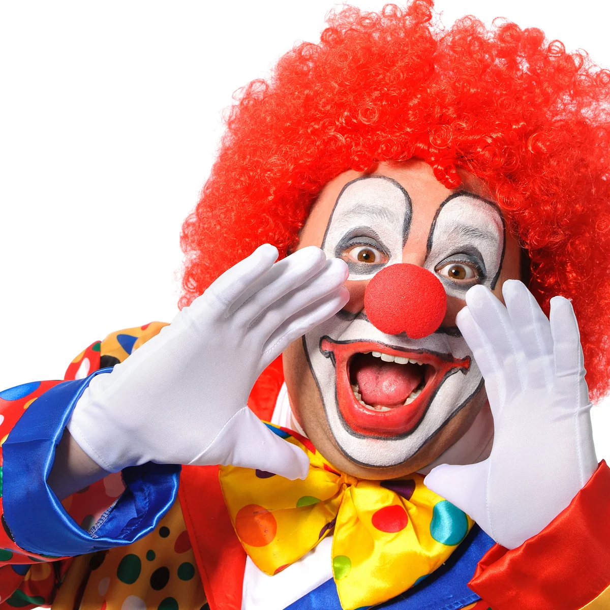

# DESIGN – מחולל בדיחות מבוסס AI

מסמך עיצוב ממשק המבוסס על `PRD.md` ועל תמונות ה-Wireframes, ה-Style Guide וה-Mockups. ה-PRD הוא המקור המחייב להיקף המוצר ולהתנהגות; התמונות הן מקורות למבנה ולסגנון. הטקסטים בממשק הם בעברית, בכיווניות RTL.

## 1. Screens – מסכי האפליקציה

### תיעוד מקורות חזותיים

**Wireframes – מבנה ופריסת הרכיבים:**

**Mockups – אופן היישום החזותי:**

> **הבחנה בין התצוגות להיקף המוצר:** בתמונות מופיעות שלוש תצוגות שכותרותיהן "מסך הבית", "מסך בדיחה" ו"מסך אודות". על פי ה-PRD, היישום כולל **מסך מוצר אחד**: הזנת נושא ויצירת בדיחה באותו עמוד. לכן "מסך הבית" ו"מסך בדיחה" הם **שני מצבים של אותו מסך**, ולא שני עמודים נפרדים. "מסך אודות" וקישורי המדיניות המוצגים בתמונות לא אושרו ב-PRD, ומתוארים בהמשך לצורך נאמנות למקורות בלבד; אין לממשם כחלק מההיקף הנוכחי ללא אישור שינוי מוצר.

### 1.1 מסך הבית – מצב הזנת נושא

- **מטרה:** הזנת נושא אופציונלי ויצירת בדיחה.
- **מבנה ותוכן:** כותרת בולטת "מחולל בדיחות" ומתחתיה כותרת המשנה "בדיחה חדשה בכל נושא שתרצו"; אזור הזנת נושא מיושר RTL עם Placeholder "הכניסו נושא לבדיחה..."; מונה תווים `0/100` מתחת לשדה; כפתור פעולה ראשי "צור בדיחה"; אזור הבדיחה מתחת לפעולה.
- **אזור הבדיחה במצב ההתחלתי (מצב ריק):** כרטיס בהיר במסגרת מקווקוות עדינה (כמו ב-Wireframe), ובמרכזו איור הליצן (`clown.webp`, ראו 2.4) והטקסט "הבדיחה תופיע כאן אחרי הלחיצה על הכפתור". זה מחליף את הליצן הגדול שבמוקאפ, כך שהשדה והכפתור **נשארים באותו מקום** בכל המצבים ואין קפיצה של התוכן.
- **פעולות וניווט:** המשתמש מזין נושא או משאיר שדה ריק ולוחץ על "צור בדיחה". התוכן מופיע **באותו עמוד**, לא באמצעות ניווט לעמוד אחר. שינוי הנושא כשלעצמו לא מחליף בדיחה קיימת. כשהשדה אינו ריק מופיע בצדו השמאלי כפתור ✕ לניקוי (כמו ב-Wireframe וב-Mockup).
- **התאמה בין המקורות:** האיורים במוקאפ הם עיטור חזותי שאינו יוצר פונקציונליות. יש לשמור שהאיורים לא ידחקו את השדה, הכפתור או תוכן הבדיחה מחוץ לאזור שימוש נוח. ה-Placeholder בלשון רבים ("הכניסו") נבחר במכוון, בהתאמה ל-Mockup ולכותרת המשנה ("שתרצו"), אף שב-Wireframe מופיע "הכנס".

### 1.2 מסך בדיחה – מצב תוצאה באותו עמוד

- **מטרה:** קריאת הבדיחה שנוצרה והעתקתה אם הושלמה.
- **מבנה ותוכן:** אותה כותרת, אותו שדה נושא ואותו כפתור פעולה; מתחתיהם Card בהיר עם טקסט הבדיחה, מיושר RTL, ובתחתיתו כפתור "העתק בדיחה". איור החתול שבמוקאפ קשור לנושא "חתולים" בלבד, ולכן **אינו מוצג**; אין דרישה ליצור תמונה לכל בדיחה.
- **מצב המתנה:** מהלחיצה ועד הגעת הטקסט הראשון, ה-Card מציג את מחוון ההמתנה מה-Style Guide: שלוש נקודות כחולות מהבהבות והטקסט "יוצר בדיחה...". עם הגעת הטקסט הראשון המחוון מתחלף בטקסט הבדיחה.
- **פעולות וניווט:** לחיצה על "צור בדיחה" יוצרת בדיחה נוספת ומחליפה את הקיימת באותו אזור. בזמן Streaming אותו כפתור משתנה ל"עצור"; הטקסט מוזרם בהדרגה. כפתור ההעתקה מוסתר עד להשלמה מלאה. "העתק בדיחה" פעיל **רק אחרי סיום מלא**. עצירה או ניתוק מותירים טקסט חלקי אך ללא אפשרות העתקה באמצעות הכפתור. שגיאות מופיעות באזור הממשק הנוכחי ללא ניווט.
- **דגש:** השדה, מונה התווים וכפתור היצירה נשארים באותה פריסה גם במצב תוצאה. אין ליצור מסך תוצאה נפרד.

### 1.3 מסך אודות – תצוגה שקיימת בתמונות בלבד (לא כלולה ב-PRD)

- **מטרה חזותית בתמונות:** הצגת מידע על האפליקציה.
- **מבנה ותוכן כפי שמופיע במקורות:** Header עם "אודות" וסימן חזרה; איור ליצן, כותרת "מחולל בדיחות", תווית גרסה `1.0`, פסקת הסבר ושלוש שורות: "איך זה עובד?", "מדיניות פרטיות" ו"תנאי שימוש".
- **פעולות וניווט:** התמונות מרמזות על חזרה וקישורים, אך ה-PRD **אינו מגדיר** מסך אודות, דרך להגיע אליו או עמודי יעד. לכן **אין להוסיף ניווט או לממש את הקישורים האלה** על סמך ה-Mockup בלבד. אם המוצר יורחב בעתיד, יש לאשר תחילה את המסך ואת פעולותיו ב-PRD.

### מבנה ניווט כללי

במוצר המאושר אין תפריט ניווט בין עמודים: כל פעולות יצירת הבדיחה, הצגתה, עצירתה והעתקתה מתקיימות בעמוד יחיד. ההתקנה כ-PWA מתבצעת דרך הדפדפן, ללא כפתור התקנה בממשק. מצב Offline ותקלות מוצגים על אותו עמוד ולא כמסכים נפרדים. בתחתית העמוד מוצגת שורה קטנה באפור: "הבדיחות נוצרות באמצעות בינה מלאכותית".

### 1.4 טבלת טקסטים בממשק

כל הטקסטים שהמשתמש רואה, במקום אחד:

| מקום / מצב | טקסט |
|---|---|
| שם האפליקציה (כותרת, לשונית דפדפן, `name` ו-`short_name` ב-Manifest) | מחולל בדיחות |
| כותרת משנה | בדיחה חדשה בכל נושא שתרצו |
| Placeholder של שדה הנושא | הכניסו נושא לבדיחה... |
| מונה תווים | `<מספר>/100` |
| תווית נגישה לכפתור ✕ | נקה נושא |
| כפתור ראשי | צור בדיחה |
| כפתור ראשי בזמן יצירה | עצור |
| מצב ריק | הבדיחה תופיע כאן אחרי הלחיצה על הכפתור |
| מחוון המתנה | יוצר בדיחה... |
| כפתור העתקה | העתק בדיחה |
| אחרי העתקה מוצלחת (כשתי שניות) | הועתק! |
| כשל העתקה | לא הצלחנו להעתיק. אפשר לסמן את הטקסט ולהעתיק ידנית. |
| אין אינטרנט | אין חיבור לאינטרנט. בדקו את החיבור ונסו שוב. |
| כשל לפני קבלת טקסט (שרת / AI) | מצטערים, משהו השתבש. נסו שוב בעוד רגע. |
| הבדיחה נקטעה באמצע | הבדיחה נקטעה באמצע. אפשר לנסות שוב. |
| חריגה מהגבלת קצב (`429`) | יצרת יותר מדי בדיחות בזמן קצר. אפשר לנסות שוב בעוד רגע. |
| נושא לא תקין (`400`) | הנושא ארוך מדי או לא תקין. נסו נושא קצר יותר. |
| שורת תחתית | הבדיחות נוצרות באמצעות בינה מלאכותית |

בעצירה יזומה ("עצור") לא מוצגת הודעה; הטקסט החלקי פשוט נשאר.

## 2. Style Guide – השפה העיצובית

**Style Guide – מקור צבעים, טיפוגרפיה ורכיבי UI:**

### 2.1 Color Palette

הצבעים הבאים מופיעים כקודי HEX ב-Style Guide. השתמשו בהם כ-Design Tokens, תוך שמירה על ניגודיות מספקת לטקסטים ולפעולות:

| Token | HEX | תפקיד |
|---|---|---|
| Primary Red | `#FF2D2D` | כפתור ראשי, כותרות והדגשות הומוריסטיות |
| Sunny Yellow | `#FFD600` | הדגשות איור ואלמנטים שמחים |
| Bright Blue | `#0066FF` | אייקונים והדגשות משלימות |
| Orange / Coral | `#FF7A3D` | צבע תומך לאיורים |
| Success Green | `#22C55E` | צבע משני המופיע בפלטה; אין ליצור סטטוס הצלחה חדש רק בגללו |
| Off White | `#FFFDF9` | רקע בהיר וחמים |
| Light Gray | `#E5E7EB` | קווי הפרדה וגבולות עדינים |
| Charcoal | `#1F2937` | טקסט ראשי |

**גוונים נגזרים** (אינם ב-Style Guide; נוספו לצורך קריאות ונגישות, מתוך אותה משפחת צבעים):

| Token | HEX | תפקיד |
|---|---|---|
| Soft Pink | `#FFE5E5` | רקע כפתור "עצור", כפתור ההעתקה וקופסת השגיאה |
| Text Red | `#C41E1E` | טקסט ואייקון אדומים על רקע בהיר או ורוד (ניגודיות של כ-5:1) |
| Muted Gray | `#6B7280` | מונה תווים, טקסט מצב ריק ושורת התחתית |

**יישום במוקאפ:** כותרות אדומות, כפתור יצירה אדום בולט, כפתור העתקה בגוון אדום בהיר, משטחים לבנים ורקע בגוון שמנת. הצהוב והכחול מופיעים בעיקר באיורים ובאייקונים. אין להפוך את כל הרקע לצבעוני; האזור האינטראקטיבי נשאר נקי.

**נגישות וניגודיות:** טקסט לבן על `#FF2D2D` עומד בתקן הנגישות רק כטקסט גדול, ולכן הטקסט בכפתור הראשי יהיה **מודגש ובגודל 19px לפחות**. טקסט אדום בגודל רגיל על רקע בהיר משתמש ב-Text Red ולא ב-Primary Red.

### 2.2 Typography

ה-Style Guide מציג את משפחות הגופנים והגדלים הבאים כדוגמאות להיררכיה. בגופנים בעלי עברית, יש לוודא תמיכה אמיתית בגליפים בעברית:

| רמה | משפחה המצוינת ב-Style Guide | גודל מומלץ | שימוש |
|---|---|---|---|
| Display Heading | Rubik Bold | 32–40px | כותרת האפליקציה הבולטת |
| Heading | Heebo Bold | 24–28px | כותרות אזורי תוכן |
| Subheading | Heebo Medium | 18–20px | הנחיות קצרות וכותרות משנה |
| Body Text | Assistant Regular | 14–16px | פסקאות, תוויות וטקסט עזר |

ה-Mockups מציגים כותרת "מחולל בדיחות" עבה ואקספרסיבית, לעיתים בקשת חזותית; בפריסה רספונסיבית יש להעדיף קריאות ושמירה על סדר הטקסט התקין. טקסט בדיחה יוצג בגודל קריא ועם גובה שורה נדיב, בלי להכתיב אורך קשיח לתוכן.

### 2.3 UI Style

- **Header:** כותרת בולטת באדום, טקסט משנה קצר בשחור/Charcoal, ברקע Off White. קישוטים צבעוניים משניים בלבד.
- **Text Input:** שדה לבן, Border דק בגוון Light Gray, פינות מעוגלות, טקסט ו-Placeholder מיושרים לימין; מונה תווים בגוון Muted Gray ממוקם מתחת לשדה. כפתור ✕ אפור קטן בצד השמאלי של השדה, מוצג רק כשהשדה אינו ריק. אייקון הנורה שבמוקאפ אינו מוצג.
- **Primary Button:** "צור בדיחה" – כפתור רחב, אדום, מלל לבן מודגש, פינות מעוגלות וצל עדין; אייקון ניצוץ קטן כפי שמוצג במקורות. בזמן Streaming התווית מתחלפת ל"עצור". ב-Style Guide מוצגת דוגמת כפתור עצירה עם צבע רקע ורוד-בהיר וסימון עצירה אדום.
- **Joke Card:** משטח לבן בעל פינות מעוגלות, צל רך וריווח פנימי נדיב; טקסט הבדיחה מיושר לימין. הפרדה עדינה בין הבדיחה לכפתור ההעתקה.
- **Copy Button:** "העתק בדיחה" – כפתור משני ברוחב מלא, רקע Soft Pink, טקסט ואייקון העתקה ב-Text Red, בהתאם ל-Mockup. **זו חריגה מכוונת מה-Style Guide** (שם הכפתור לבן עם מסגרת כחולה), כי הגרסה הוורודה משתלבת טוב יותר בשאר העמוד. מוצג רק לבדיחה שהושלמה. אחרי העתקה התווית מתחלפת ל"הועתק!" לכשתי שניות. אין כפתורי שיתוף או פעולות נוספות.
- **Loading Indicator:** לפי ה-Style Guide — שלוש נקודות כחולות (Bright Blue) מהבהבות והטקסט "יוצר בדיחה...", בתוך ה-Card. מוצג רק עד הגעת הטקסט הראשון; משם הטקסט עצמו מוזרם. אין מסך טעינה נפרד.
- **Error Message:** לפי ה-Style Guide — קופסה ברקע Soft Pink, פינות מעוגלות, אייקון "!" עגול אדום וטקסט ב-Text Red. מוצגת מתחת לכפתור הראשי (מעל ה-Card), כך שטקסט חלקי שכבר התקבל נשאר גלוי ב-Card. ההודעה נעלמת עם התחלת יצירה חדשה.
- **Menus / Navigation:** אין תפריט או ניווט רב-מסכי בגרסה המאושרת. שורות הניווט במוקאפ "אודות" הן דוגמה חזותית בלבד, ואינן חלק מהיישום המאושר.

### 2.4 Visual Style

- **אווירה:** הומוריסטית, שמחה, ידידותית וצבעונית, לצד מבנה UI נקי ומודרני. הבחירה החזותית מבוססת על ליצן צבעוני, הבעות צחוק ודמויות מאוירות מתוך Inspiration Board ו-Mockups.
- **תמונות ואיורים:** איור ליצן אדום-שיער ודמויות מצוירות שמחות הם העוגנים החזותיים. התמונות המוטמעות במסמך אינן קובצי Asset נפרדים, ואין לחתוך מהן איורים. איור החתול במוקאפ הוא דוגמה בלבד, לא פיצ'ר מותאם נושא.
- **קובצי האיורים הרשמיים** (נמצאים ב-`spec/`, ויועתקו לתיקיית `public/illustrations/` של האפליקציה בפורמט מותאם לאינטרנט, למשל WebP):

  

  

  | קובץ | תוכן | שימוש באפליקציה |
  |---|---|---|
  | `clown.webp` (1200×1200, רקע לבן) | ליצן צועק, ידיים סביב הפה | במרכז כרטיס המצב הריק, מעל טקסט ההכוונה. הרקע הלבן של התמונה משתלב ברקע הלבן של הכרטיס, ולכן אין צורך בהסרת רקע. מוצג בגודל של כ-160–200px. |
  | `funny jokes.png` (866×614, רקע שקוף) | שלוש דמויות צוחקות | קישוט בתחתית העמוד, מעל שורת התחתית, בכל מצבי העמוד (כמו במוקאפ "מסך הבית"). רוחב מרבי של כ-280px, ממורכז. **הכיתוב האנגלי "Funny Jokes" שבחלק התחתון של התמונה נחתך** — רק הדמויות מוצגות, כי הממשק בעברית בלבד. |

- האיורים דקורטיביים בלבד: `alt=""` לנגישות, ללא פעולות. הם נטענים בגודל מותאם (`next/image`) כדי לא להאט את העמוד.
- 😂 משמש כקישוט קטן בלבד (למשל ליד הכותרת); הליצן והדמויות מגיעים מהקבצים.
- **צורות ופינות:** פינות מעוגלות; ב-Style Guide מופיע טווח `8–16px` כרדיוס טיפוסי. Card וכפתורים במוקאפ נראים רכים ומעוגלים במיוחד.
- **צללים וגבולות:** צללים עדינים מתחת ל-Card ולכפתורים, Border דק לשדות; ללא קווי מתאר כבדים במשטחי תוכן.
- **Spacing:** ריווח נדיב בין כותרת, שדה, כפתור ותוצאת הבדיחה. ה-Style Guide אינו מציין סולם Spacing מספרי מחייב, לכן אין להמציא Token מספרי כמפרט מקור.
- **Layout:** סדר אנכי עקבי: כותרת ← תיאור קצר ← שדה נושא ומונה ← כפתור פעולה ← (הודעת שגיאה) ← אזור בדיחה ← איור הדמויות ← שורת תחתית. האיור משתלב סביב התוכן, ללא פגיעה בהיררכיה.
- **מובייל, טאבלט ו-Desktop:** כל התוכן נמצא בעמודה אחת ממורכזת ברוחב מרבי של **560px**, עם שוליים צדדיים של 16px לפחות במסכים צרים. במסכים רחבים יותר הרקע Off White ממלא את הצדדים, והעמודה לא נמתחת. גודל הכותרת עולה בהדרגה בין 32px במובייל ל-40px ב-Desktop.
- **ערכת צבעים:** בהירה בלבד; אין מצב כהה.
- **Iconography:** אייקונים פשוטים, מעוגלים, ברורים ומשעשעים במידה; אייקון העתקה, ניצוץ ועצירה הם הרלוונטיים לפעולות שאושרו. אייקונים דקורטיביים אינם מוסיפים פעולות.
- **תנועה:** אנימציות עדינות יכולות לתמוך בסגנון, אך לא להחליף את ה-Streaming הפונקציונלי; יש לשמור על קריאות ויציבות Layout בזמן זרימת הטקסט.

### 2.5 אייקון האפליקציה (PWA)

- ריבוע ברקע Primary Red (`#FF2D2D`) עם פינות מעוגלות, ובמרכזו פרצוף סמיילי צוחק פשוט בלבן (עיגול, שתי עיניים וחיוך פתוח), מצויר כצורות SVG ולא כאמוג'י, כדי שייראה זהה בכל מכשיר.
- מקור אחד: קובץ SVG בפרויקט, שממנו נוצרים כל הגדלים הנדרשים (ראו `ARCHITECTURE.md`, סעיף PWA). בגרסת `maskable` הפרצוף קטן יותר וממוקם במרכז, כדי שלא ייחתך במכשירים שמעגלים את האייקון.
- צבעי ה-Manifest: רקע `#FFFDF9`, צבע ערכת נושא `#FF2D2D`.
- אם בהמשך יסופק אייקון מעוצב, הוא יחליף את קובץ ה-SVG.

### 2.6 שפה וכיווניות

- שפת הממשק והבדיחות: **עברית בלבד**, בכיווניות `RTL` וביישור טקסט לימין היכן שמוצג תוכן עברי.
- המספרים במונה (`0/100`) וסימון הגרסה המופיע בדוגמת האודות (`1.0`) ישמרו על סדר ספרות קריא.
- שמות מקצועיים במסמך, כגון `Card`, `Streaming`, `RTL`, נשארים באנגלית; תוויות UI שנראות למשתמש נשארות בעברית.

### 2.7 גבולות המימוש

העיצוב המאושר מוכתב בידי ה-PRD: **עמוד אחד בלבד**, ללא הרשמה, מסד נתונים, שיתוף, קישורי אודות או הפקת תמונות נושא. כשהדוגמאות החזותיות מציגות דבר שאינו חלק מה-PRD, יש להשתמש בהן כהשראת צבע, טיפוגרפיה, מרווחים וסגנון בלבד, ולא כהרחבת יכולות המוצר. כל הוספת מסך או פעולה מחייבת עדכון דרישות המוצר לפני מימוש.
